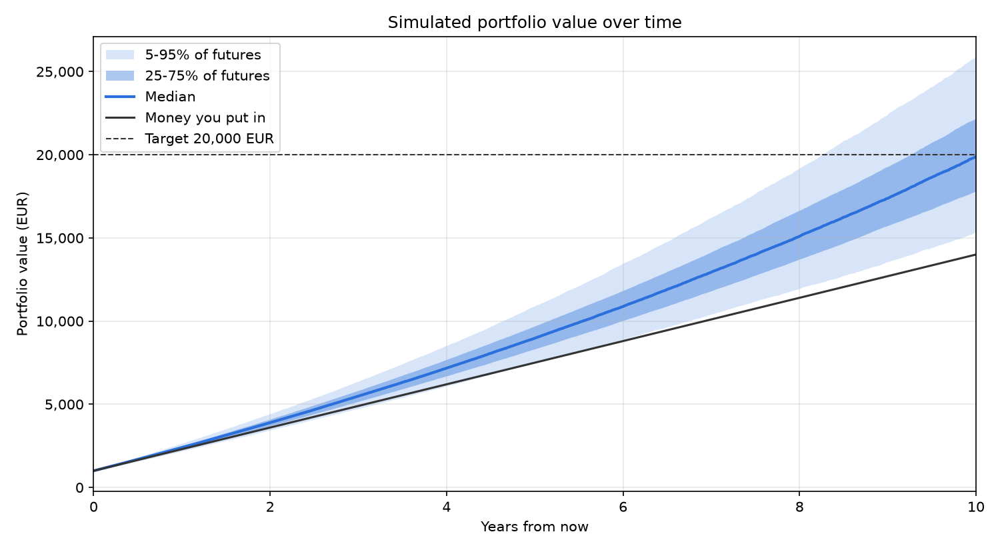

# Portfolio Monte Carlo Simulator

How might an ETF portfolio with a regular weekly contribution grow over the next 10 years? How likely is it to reach a target value, and how much does investing actually gain compared with simply keeping the same money in a savings account?

This tool downloads weekly prices for a set of EUR-listed ETFs, estimates their returns and correlations, and simulates 10,000 possible futures. Each week a contribution is added, and the contribution can rise with inflation. The same money is also put into a savings account, so the result shows the opportunity cost of each choice.



*Example inputs: €1,000 start, €25 per week rising 2% per year (raised every quarter), 19 ETFs, a savings account at 2%, 10 years, 10,000 simulations.*

## Method

1. **Data.** Weekly adjusted close prices from Yahoo Finance (`yfinance`), cached as CSV. Only weeks where every ETF has a price are kept. One-week data errors (a price that jumps and immediately comes back while the rest of the market is calm) are detected with a robust z-score (MAD) and interpolated.
2. **Log returns.** `r_t = ln(P_t / P_{t-1})`. Log returns add up over time, so a multi-week return is just a sum.
3. **Parameters.** The mean vector μ and the sample covariance matrix Σ of the weekly log returns.
4. **Correlated simulation.** Each week's return vector is drawn as `μ + L·z`, with `z ~ N(0, I)` and `L` the Cholesky factor of Σ (`Σ = L·Lᵀ`). This keeps the historical correlations between ETFs. Ignoring them would make the risk look about 3 times smaller for this portfolio.
5. **Contributions.** A weekly amount that can stay flat or be raised every quarter, either with inflation or at its own growth rate.
6. **Portfolio.** Every week the holdings grow, the contribution is added, and the portfolio is rebalanced to the target weights.
7. **Savings-account alternative.** The same start value and contributions earn a fixed interest rate. Technically it is a one-asset portfolio with zero volatility, so it reuses the same tested code.
8. **Summary.** The 5th, 50th and 95th percentiles of the final value; the probability of reaching the target; the 5% Value at Risk (money put in minus the 5th percentile); the growth share of the median; the probability of beating the savings account; and the extra gain from investing at the 5th, 50th and 95th percentiles.

## Result (example inputs, nominal EUR)

| | |
|---|---|
| Money put in | €15,341 |
| Final value: 5% / median / 95% | €16,734 / €21,539 / €27,884 |
| Chance to reach €20,000 | 67.6% |
| Savings account at 2% instead | €17,024 |
| Chance the portfolio beats the savings account | 93.7% |
| Extra from investing: 5% / median / 95% | −€290 / +€4,515 / +€10,860 |

In a typical future, investing ends about €4,500 ahead of the savings account. In about 1 in 16 futures, however, the savings account would have been the better choice. Most of a typical final value is still the money put in: over 10 years, the saving rate matters more than the returns.

## Limitations

- **The past is not the future.** The parameters come from about 8.5 years of data (2018–2026), mostly a good period for stocks and gold. The means in particular are estimated very imprecisely.
- **Normal distribution: no fat tails.** Real markets have sudden crashes (like March 2020) far more often than a normal distribution predicts, so the real downside is probably larger.
- **Constant parameters.** Volatility and correlations are assumed to stay the same for 10 years. In reality correlations tend to rise in a crisis.
- **Fixed inflation and savings rate.** Both are single numbers set by the user. In reality they change over time and move together (version 2 will simulate them).
- **One currency.** Everything is in EUR. There is no exchange-rate risk (also planned for version 2).
- **No fees, taxes or trading costs.** ETF fees and taxes would lower every outcome, and investments and savings are often taxed differently.
- **Timing.** Weekly rebalancing is assumed, with no costs. Contributions are added at the end of each week.

## How to run

```bash
conda create -n portfolio-sim python=3.12 -y
conda activate portfolio-sim
pip install -r requirements.txt

python main.py      # run the full simulation, print the summary, show the charts
pytest -v           # run the tests
```

## Settings

All settings are in `src/config.py`:

| Setting | Meaning |
|---|---|
| `tickers` / `weights` | ETFs (Yahoo Finance symbols) and their weights, which must add up to 1 |
| `start_value`, `weekly_contribution` | Money in, in EUR |
| `years`, `n_sims`, `seed` | Horizon, number of simulations, random seed |
| `target` | The final value to reach |
| `inflation` | Inflation per year (used for raising contributions and for today's-money results) |
| `index_contributions` | `True` raises contributions over time; `False` keeps them flat |
| `contribution_growth` | `None` follows inflation, or a fixed growth rate such as `0.05` |
| `index_every_weeks` | How often contributions are raised (13 = every quarter) |
| `savings_rate` | Interest on the savings-account alternative |
| `target_in_todays_money` | Whether the target is in today's buying power or in future euros |
| `report_in_todays_money` | Whether to also show results adjusted for inflation |
| `history_years` | Years of past data to learn from (e.g. `10`); `None` uses every week that all ETFs have. The youngest ETF sets the limit |

To use your own amounts without committing them, create `my_config.py` in the project root. It is listed in `.gitignore`, and any key in it overrides `src/config.py`:

```python
PRIVATE = {"start_value": 5000, "weekly_contribution": 50, "target": 50_000, "savings_rate": 0.02}
```

## Project structure

```
main.py              runs everything in order
src/config.py        settings and validation
src/data.py          download, cache and clean prices
src/returns.py       log returns, mean and covariance
src/simulate.py      Cholesky Monte Carlo, contributions, portfolio and savings account
src/analyze.py       percentiles, probability, VaR, today's money, savings comparison
src/plots.py         fan chart and histogram
tests/               pytest tests with known answers
```

## Planned (version 2)

- Separate currencies for investments and savings, with simulated exchange-rate risk
- Simulated inflation and interest rates (autoregressive models on Eurostat data)
- A bootstrap method next to the normal distribution (fat tails), rebalancing on/off, maximum drawdown

## Note on AI use

I Claude coded shit out of this project as you can probably tell.